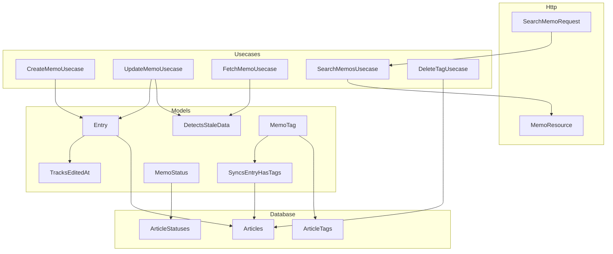
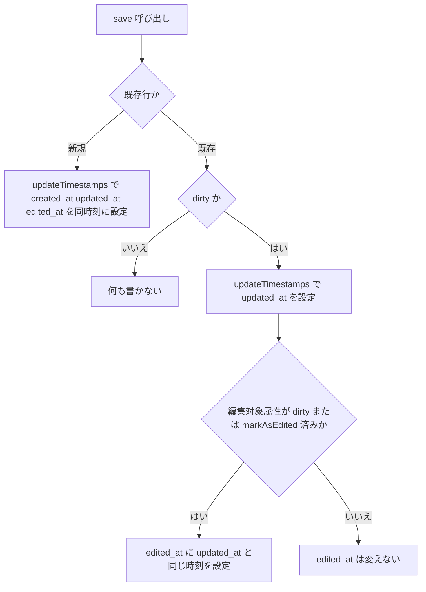
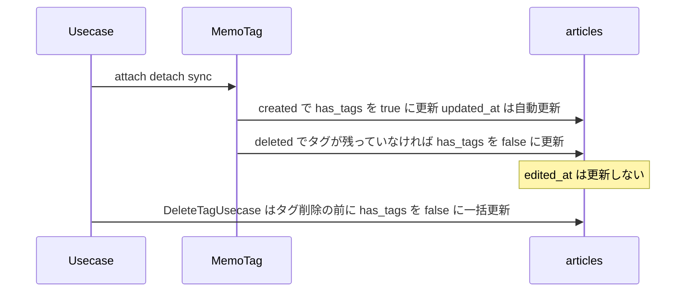
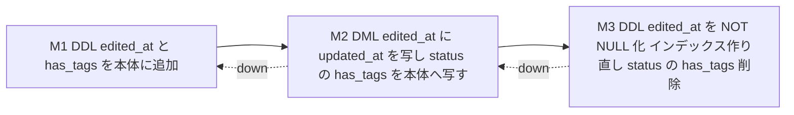

# Design Document

## Overview

**Purpose**: メモ・ブックマークの日時を、次の2つに分ける。

- `updated_at`：行の更新日時（Laravel 標準）
- `edited_at`：ユーザーが内容を編集した日時

これにより、ユーザーの編集以外で本体の行を更新しても、並び順や排他制御に影響しないようにする。あわせて `has_tags` を本体テーブルへ戻し、タグなし検索を本体のインデックスだけで行う。

**Users**: メモを使うユーザーは、編集日時で一覧を並べ替え・絞り込みでき、自分が編集していない変化（タグ削除など）で並び順が変わったり、保存が競合と判定されたりしなくなる。

**Impact**:
- 本体テーブルに `edited_at` と `has_tags` を追加する
- status テーブルから `has_tags` を削除する
- メモ API の `updated_at` 系のパラメータとレスポンス項目を `edited_at` に改名する
- `updated_at` を変えないための特別扱いをやめる

### Goals
- 編集日時を、作成と編集（タイトル・本文・星・タグの変更）のときだけ更新する（1.1〜1.5、2.1〜2.5）
- 並べ替え・期間絞り込み・レスポンス・楽観的排他制御で、編集日時を使う（3.1〜3.5、4.1〜4.3）
- タグなし検索を、本体テーブルの複合インデックスで20ms以下にする（5.1〜5.7、6.1〜6.5）
- 既存データと旧データ移行を新しい構造に合わせる（7.1〜7.5、8.1〜8.2）

### Non-Goals
- タグ（`tags`）の `updated_at` の意味と、タグ検索の並べ替えの変更
- ブックマーク API の実装（ブックマークはデータ層だけを対象にする）
- メモ画面の実装（フロントエンドにはまだメモの画面が無い。対象は生成型の更新まで）
- 旧 API パラメータ名（`sort=updated_at` など）の互換対応

## Requirements Traceability

| Requirement | Summary | Components | Interfaces | Flows |
|-------------|---------|------------|------------|-------|
| 1.1 | 編集日時の保持 | EditedAtMigrations、Entry | `edited_at` カラム | — |
| 1.2 | 作成時は作成日時と同時刻 | TracksEditedAt | `updateTimestamps()` 拡張 | 保存フロー |
| 1.3 | タイトル・本文・星の変更で更新 | TracksEditedAt、Memo | `editableAttributes()` | 保存フロー |
| 1.4 | タグの変更で更新 | TracksEditedAt、UpdateMemoUsecase | `markAsEdited()` | 保存フロー |
| 1.5 | 変更なしでは更新しない | TracksEditedAt | `save()` の dirty 判定 | 保存フロー |
| 1.6 | 行の更新では常に `updated_at` を更新 | SyncsEntryHasTags、DeleteTagUsecase | Eloquent Builder の `update()` | タグ同期フロー |
| 2.1 | タグ削除で `edited_at` を変えない | DeleteTagUsecase | — | タグ同期フロー |
| 2.2 | タグ名の変更で変えない | （変更なし。タグ名はタグ側だけを更新） | — | — |
| 2.3 | 閲覧数の加算で変えない | （変更なし。status テーブルを更新） | — | — |
| 2.4 | ゴミ箱への移動・復元で変えない | TracksEditedAt | — | 保存フロー |
| 2.5 | タグ削除で並び順を変えない | SearchMemosUsecase | `edited_at` で並べ替え | — |
| 3.1、3.2 | `edited_at` で並べ替え・期間絞り込み | SearchMemoRequest、SearchMemosUsecase | API 契約 | — |
| 3.3 | レスポンスで `edited_at` を返す | MemoResource | API 契約 | — |
| 3.4 | 旧名のパラメータはエラー | SearchMemoRequest | バリデーション | — |
| 3.5 | フロントエンドで `edited_at` を表示 | 生成型（`schema.d.ts`） | — | — |
| 4.1〜4.3 | 楽観的排他制御は `edited_at` で判定 | DetectsStaleData | `hasBeenEditedSinceRetrieval()` | — |
| 5.1、5.2、5.7 | `has_tags` は本体、`count` は status | EditedAtMigrations、Entry、MemoStatus、BookMarkStatus | — | — |
| 5.3〜5.6 | `has_tags` の同期（ゴミ箱を含む） | SyncsEntryHasTags、MemoTag、BookMarkTag、DeleteTagUsecase | `parentEntryQuery()` | タグ同期フロー |
| 6.1〜6.3 | タグなし検索 | SearchMemosUsecase | `where('has_tags', false)` | — |
| 6.4、6.5 | 20ms以下、DB 設定に依存しない | EditedAtMigrations | 複合インデックス | — |
| 7.1〜7.5 | 既存データの移行とロールバック | EditedAtMigrations | Batch 契約 | 移行フロー |
| 8.1、8.2 | 旧データ移行 | ImportLegacyDataCommand | Batch 契約 | — |
| 9.1〜9.3 | ドキュメント | Documentation | — | — |

## Architecture

### Existing Architecture Analysis

- MVC + Usecase 構成。メモの業務処理は `app/Usecases/Memo/` の `__invoke` で行う。
- `Entry`（`Memo` / `BookMark` の抽象基底）は、トレイトで共通の振る舞いを持つ。
  - `DetectsStaleData`：楽観的排他制御
  - `HasStatusRow`：status 行の作成
  - `Trashable` + `SoftDeletes`：ゴミ箱
- `has_tags` の同期は、中間モデル（`MemoTag` / `BookMarkTag`）の `created` / `deleted` イベントで行う（`SyncsEntryHasTags`）。ON DELETE CASCADE ではイベントが発火しないため、タグ削除だけは `DeleteTagUsecase` が事前に同期する。
- 現在、`has_tags` は `EntryStatus`（`MemoStatus` / `BookMarkStatus` の基底）にある。本体の `updated_at` が「編集日時」を兼ねているため、別テーブルにしている。

### Architecture Pattern & Boundary Map



**Architecture Integration**:
- **Selected pattern**: 既存の MVC + Usecase を維持する。「編集日時の更新」と「`has_tags` の同期」は、#118 と同じくモデル層（トレイト・中間モデルのイベント）に置き、Usecase ごとの書き忘れを防ぐ。
- **Domain boundaries**:
  - `articles` / `book_marks`：ユーザーが編集する項目と、検索条件になる項目（`has_tags`）を持つ
  - status テーブル：書き込みが頻繁で、検索の絞り込みに使わない項目（`count`）だけを持つ
- **Existing patterns preserved**: Usecase の `__invoke`、モデルの共通トレイト、中間モデルのイベントによる同期、DDL / DML を分けた3段階のマイグレーション、旧データ移行コマンドでの生クエリ insert
- **New components rationale**: `TracksEditedAt` は、作成・編集時に `edited_at` を `created_at` / `updated_at` と同じ時刻で設定する責務を1か所にまとめる
- **Steering compliance**: DB は UTC で保存し、API は UTC の ISO 8601 で返す。API 変更後は ziggy・openapi を再生成する

### Technology Stack

| Layer | Choice / Version | Role in Feature | Notes |
|-------|------------------|-----------------|-------|
| Backend | PHP 8.3 / Laravel 12 | モデルのタイムスタンプ拡張、Usecase・Request・Resource の変更 | 新しい依存なし |
| Data | MariaDB（開発 12.0）、テストは SQLite | カラム追加・インデックス作り直し・データ移行 | セッション変数（`optimizer_join_limit_pref_ratio`）は使わない |
| Frontend | TypeScript / openapi 生成型 | `schema.d.ts` の再生成 | 画面の変更なし |

## System Flows

### 保存フロー（`edited_at` の設定）



- ゴミ箱への移動（`delete()`）は、SoftDeletes がクエリで直接更新するため、このフローを通らない。`edited_at` は変わらない。
- 復元（`restore()`）はこのフローを通る。ただし変更されるのは `deleted_at` だけなので、`edited_at` は変わらない。

### タグ同期フロー（`has_tags` と `updated_at`）



- 同期のクエリは `withTrashed()` 付きで、ゴミ箱内も対象にする（5.6）。
- Eloquent Builder の `update()` を使い、`updated_at` を自動で更新する（1.6）。`toBase()` は使わない。

### 移行フロー



## Components and Interfaces

| Component | Domain/Layer | Intent | Req Coverage | Key Dependencies | Contracts |
|-----------|--------------|--------|--------------|------------------|-----------|
| TracksEditedAt（新規） | Model / Trait | 作成・編集時に `edited_at` を設定する | 1.2〜1.5、2.4 | HasTimestamps (P0) | Service, State |
| Entry / Memo / BookMark | Model | `edited_at`・`has_tags` のキャストと既定値、編集対象属性の宣言 | 1.1、1.3、5.1 | TracksEditedAt (P0) | State |
| DetectsStaleData | Model / Trait | 取得後に編集されたかを `edited_at` で判定する | 4.1〜4.3 | Entry (P0) | Service |
| SyncsEntryHasTags / MemoTag / BookMarkTag | Model / Pivot | 紐付けの増減で本体の `has_tags` を同期する | 1.6、2.1、5.3、5.4、5.6 | Entry (P0) | Event |
| MemoStatus / BookMarkStatus / StatusRow | Model | `count` だけを持つ status 行 | 5.2、5.7 | — | State |
| UpdateMemoUsecase | Usecase | タグだけの変更を編集として扱う | 1.4、4.1 | TracksEditedAt (P0) | Service |
| SearchMemosUsecase / SearchMemoRequest | Usecase / Request | `edited_at` で並べ替え・絞り込み、本体の `has_tags` でタグなし検索 | 2.5、3.1、3.2、3.4、6.1〜6.3 | Entry (P0) | API |
| MemoResource | Resource | `edited_at` を返す | 3.3 | — | API |
| DeleteTagUsecase | Usecase | タグ削除の前に本体の `has_tags` を同期する | 1.6、2.1、5.5、5.6 | Entry (P0) | Service |
| EditedAtMigrations（新規 M1〜M3） | Database | カラム・インデックス・データの移行 | 1.1、5.1、5.2、6.4、7.1〜7.5 | — | Batch |
| ImportLegacyDataCommand | Console | 旧データの `edited_at` と `has_tags` を本体へ設定する | 8.1、8.2 | — | Batch |
| 生成型（schema.d.ts / ziggy） | Frontend | API の型を `edited_at` に更新する | 3.5 | MemoResource (P0) | — |
| Documentation | doc | DB・モデル・API 定義の更新 | 9.1〜9.3 | — | — |

### Model Layer

#### TracksEditedAt（新規）

| Field | Detail |
|-------|--------|
| Intent | 作成時と、ユーザーが編集した保存のときだけ、`edited_at` を `created_at` / `updated_at` と同じ時刻で設定する |
| Requirements | 1.2、1.3、1.4、1.5、2.4 |

**Responsibilities & Constraints**
- `Entry` が use する。Eloquent のタイムスタンプ更新（`updateTimestamps()`）を拡張し、同じ時刻を `edited_at` に設定する。
- 新規作成時は、常に `edited_at` を設定する。ただし呼び出し側が `edited_at` を明示した場合はその値を優先する（テスト・データ移行用）。
- 既存行の更新時は、編集対象の属性が変更されているか、`markAsEdited()` が呼ばれているときだけ設定する。
- クエリビルダーの `update()`、SoftDeletes の論理削除、status テーブルの更新は対象外（仕組み上 `edited_at` に触れない）。

**Dependencies**
- Inbound: `Entry` — トレイトとして利用する（P0）
- External: `Illuminate\Database\Eloquent\Concerns\HasTimestamps` — `updateTimestamps()` の拡張点（P0）

**Contracts**: Service [x] / State [x]

##### Service Interface
```php
trait TracksEditedAt
{
    /**
     * 編集とみなす属性。これらが変更された保存で edited_at を更新する。
     *
     * @return list<string>
     */
    abstract protected function editableAttributes(): array;

    /**
     * 本体の属性が変わらない編集(タグの付け替えなど)を、次の save() で編集として扱う。
     * モデルを dirty にするため、save() は必ず UPDATE を発行する。
     */
    public function markAsEdited(): static;
}
```
- Preconditions: `Entry` のサブクラスであり、`edited_at` カラムを持つ。
- Postconditions:
  - 新規作成後は `edited_at == created_at`
  - 編集の保存後は `edited_at == updated_at`
  - 編集以外の保存後は、`edited_at` が保存前と同じ
- Invariants: `edited_at <= updated_at`

**Implementation Notes**
- `editableAttributes()` は Memo が `title` / `body` / `star`、BookMark が `title` / `url` / `star` を返す。
- `markAsEdited()` の印は、保存後にクリアする（同じインスタンスで再度 `save()` しても、編集扱いが続かない）。
- Risks: 編集対象の属性を追加したら、`editableAttributes()` の更新が必要。モデル定義ドキュメントに明記する。

#### Entry / Memo / BookMark

**Responsibilities & Constraints**
- `Entry` に `TracksEditedAt` を追加する。キャストに `edited_at => datetime` と `has_tags => boolean` を、既定値に `has_tags => false` を追加する。
- `has_tags` は `$fillable` に含めない（同期処理だけが書く）。
- PHPDoc の `@property` に `edited_at`（`Carbon`）と `has_tags`（`bool`）を追加する。

#### DetectsStaleData

**Contracts**: Service [x]

##### Service Interface
```php
trait DetectsStaleData
{
    /**
     * 取得日時より後に、ユーザーの編集(edited_at)があったかを判定する。
     * 解析できない取得日時は編集済みとみなす(上書きを防ぐ)。
     */
    public function hasBeenEditedSinceRetrieval(string $fetchedAt): bool;
}
```
- 比較対象を `updated_at` から `edited_at` に変える。意味が変わるため、メソッド名も `hasBeenUpdatedSinceRetrieval` から改名する。呼び出し元は `UpdateMemoUsecase` と `FetchMemoUsecase` の2か所。
- これにより、タグ削除などの編集以外の更新では競合にならない（4.2）。

#### SyncsEntryHasTags / MemoTag / BookMarkTag

**Contracts**: Event [x]

##### Event Contract
- Subscribed events: 中間モデルの `created` / `deleted`（attach / detach / sync / toggle で発火）
- Published effects:
  - `created`：親エントリーの `has_tags` が false なら true に更新する
  - `deleted`：親エントリーにタグが残っていなければ false に更新する
- 抽象メソッドを `parentStatusQuery(): Builder<covariant EntryStatus>` から `parentEntryQuery(): Builder<covariant Entry>` に変える。実装は、`withTrashed()` を付けて本体1件に絞り込むクエリを返す（例：`Memo::withTrashed()->whereKey($this->article_id)`）。
- Eloquent Builder の `update()` で書くので、`updated_at` は自動で更新され、`edited_at` は変わらない。

#### MemoStatus / BookMarkStatus / StatusRow

- `EntryStatus` を廃止する。`MemoStatus` / `BookMarkStatus` は `StatusRow` を直接継承する。
- `StatusRow` と `HasStatusRow` のクラスコメントを、「`count`（書き込みが頻繁で、編集日時と無関係な値）を管理する」という内容に更新する。

### Usecase / HTTP Layer

#### UpdateMemoUsecase

- タグの付け替えがあった場合（`syncTags()` が true）は、`touch()` の代わりに `markAsEdited()` を呼んでから `save()` する。タグの付け替えがなく、属性も変わっていなければ、何も書かない（1.5）。
- 排他制御の判定は `hasBeenEditedSinceRetrieval()` を使う。

#### SearchMemosUsecase / SearchMemoRequest

**Contracts**: API [x]

##### API Contract（メモ検索）
| Parameter | 変更前 | 変更後 | Validation |
|-----------|--------|--------|------------|
| `sort` | `updated_at`（既定）, `created_at`, `title`, `count`, `random` | `edited_at`（既定）, `created_at`, `title`, `count`, `random` | `in:` に含まれない値は 422 |
| 期間開始 | `updated_at_range_start` | `edited_at_range_start` | `date` |
| 期間終了 | `updated_at_range_end` | `edited_at_range_end` | `date` |

- 旧名のパラメータ（`updated_at_range_*`）は、ルールに無いため無視されてしまう。3.4 を満たすため、`prohibited` ルールで受け付けないようにする（422）。
- タグなし検索は `where('has_tags', false)` に戻す。status テーブルは参照しない。
- `sort=count` の並べ替え（status テーブルのサブクエリ）は変更しない。

#### MemoResource

**Contracts**: API [x]

- レスポンスの `updated_at` を `edited_at` に置き換える。行の更新日時（`updated_at`）は返さない。
- 対象は、メモ取得・メモ検索・メモ更新の競合時のレスポンス（`saved`）。

#### DeleteTagUsecase

- 対象を `MemoStatus` / `BookMarkStatus` から、`Memo::withTrashed()` / `BookMark::withTrashed()` に変える。条件（このタグに紐付き、他のタグには紐付いていない）は変えない。
- Eloquent Builder の `update(['has_tags' => false])` で書くため、`updated_at` は更新され、`edited_at` は変わらない。

### Database / Console Layer

#### EditedAtMigrations（新規 M1〜M3）

**Contracts**: Batch [x]

##### Batch / Job Contract
- **M1（DDL）**：`articles` / `book_marks` に `edited_at`（timestamp、nullable）と `has_tags`（boolean、既定 false）を追加する。down はこの2カラムを削除する。
- **M2（DML）**：
  - up：
    - ゴミ箱内を含む全行の `edited_at` に `updated_at` を写す
    - status テーブルの `has_tags` を本体へ写す（status 行が無い本体は false のまま）
    - `DB::table()` で書き、`updated_at` は変更しない（7.3）
  - down：本体の `has_tags` を status テーブルへ書き戻す
- **M3（DDL）**：
  - up：
    - `edited_at` を NOT NULL にする
    - 本体に `(user_id, deleted_at, edited_at)` と `(user_id, has_tags, deleted_at, edited_at)` を作成してから、`(user_id, deleted_at, updated_at)` を削除する（外部キー用のインデックスを途切れさせない）
    - status テーブルから `has_tags` を削除する
  - down：status の `has_tags` カラムと旧インデックスを復元し、新しいインデックスを削除し、`edited_at` を nullable に戻す
- **Idempotency & recovery**：アプリを停止（メンテナンスモード）して実行する前提。ロールバックは M3 → M2 → M1 の順に down が走り、構造と値が移行前に戻る（7.4）。

#### ImportLegacyDataCommand

- articles / book_marks の insert で、`edited_at` に旧データの `updated_at` を設定する（8.1）。
- `has_tags` を、status テーブルではなく本体の insert で設定する。判定方法（旧中間テーブルでの紐付けの有無）は変えない（8.2）。
- status テーブルへの insert は `count` だけにする。

## Data Models

### Physical Data Model

**articles / book_marks（変更）**

| カラム | 型 | NULL | 既定値 | 備考 |
|--------|----|------|--------|------|
| `has_tags` | boolean | 不可 | false | 追加。タグが1つ以上紐付いているか |
| `edited_at` | timestamp | 不可 | — | 追加。ユーザーが内容を編集した日時（UTC） |
| `updated_at` | timestamp | 可 | NULL | 既存。意味を「行の更新日時」にする |

| インデックス | 用途 |
|--------------|------|
| `(user_id, deleted_at, edited_at)` | 追加。通常の一覧・ゴミ箱一覧の編集日時順 |
| `(user_id, has_tags, deleted_at, edited_at)` | 追加。タグなし検索 |
| `(user_id, deleted_at, updated_at)` | 削除 |

**article_statuses / book_mark_statuses（変更）**：`has_tags` を削除する。`article_id` / `book_mark_id`（主キー）・`count`・`created_at` は残す。

**Consistency & Integrity**
- `has_tags` は中間テーブルから導出する値。中間モデルのイベントと `DeleteTagUsecase` だけが書く。
- `edited_at` は `TracksEditedAt` と、データ移行（M2・旧データ移行コマンド）だけが書く。

### Data Contracts & Integration

**API Data Transfer（MemoResource）**

```typescript
interface MemoResponse {
  id: number
  title: string
  body: string
  star: number
  count: number
  tags: TagResponse[]
  is_in_trash: boolean
  is_deadline_approaching: boolean
  created_at: string | null
  edited_at: string       // 変更: updated_at から置き換え。UTC ISO 8601
  deleted_at: string | null
}
```

## Error Handling

- 旧名の検索パラメータ（`sort=updated_at`、`updated_at_range_start`、`updated_at_range_end`）は、FormRequest のバリデーションで 422 にする（3.4）。
- 排他制御の競合は、既存の `StaleDataException` のまま。判定基準だけを `edited_at` に変える。
- マイグレーションの失敗はロールバックで戻す。インデックス作り直しの順序（新規作成 → 旧削除）を守り、外部キーのエラーを避ける。

## Testing Strategy

- **Unit / Model（`EntryModelTest` ほか）**
  - 作成時に `edited_at == created_at` になる
  - タイトル・本文・星の変更で `edited_at` が更新される
  - 変更なしの `save()` では `edited_at` も `updated_at` も変わらない
  - `delete()` / `restore()` で `edited_at` が変わらない
  - `markAsEdited()` だけで `edited_at` が更新される
- **has_tags の同期（`EntryHasTagsSyncTest`）**
  - attach / detach / sync で本体の `has_tags` が変わり、`updated_at` が更新され、`edited_at` は変わらない
  - ゴミ箱内も対象になる
- **API（`SearchMemosApiTest` / `UpdateMemoApiTest` / `FetchMemoApiTest` / `DeleteTagApiTest`）**
  - `sort=edited_at` と既定値での並び順、`edited_at_range_*` での絞り込み、旧名のパラメータで 422
  - レスポンスに `edited_at` があり、`updated_at` が無い
  - タグ削除の後も並び順が変わらない
  - タグ削除の後に更新しても競合にならない
  - タグだけの付け替えで `edited_at` が更新される
  - タグなし検索（他ユーザーの除外、ゴミ箱との組み合わせ）
- **Migrations（新規テスト + 既存2テストの setUp 修正）**
  - M2 の up で、`edited_at = updated_at`（ゴミ箱を含む）になる
  - `has_tags` が status から写され、status 行が無い本体は false になる
  - `updated_at` が変わらない
  - M3 → M2 → M1 の down で、移行前の構造と値に戻る
  - 既存の `CopyCountAndHasTagsToStatusTablesMigrationTest` / `RecalculateHasTagsMigrationTest` は、setUp で新しいマイグレーションを逆順に戻してから、従来の down を呼ぶ形に直す
- **既存テストの調整**：`updated_at` を指定して並び順・期間・排他制御を作っているテストは、`edited_at` を指定する形に直す

### Performance
- 開発 DB（MariaDB）で、1ユーザー20,000件（他ユーザーを含め全10万件、本文約1KB）、タグなし件数の割合（3件・1%・10%・50%・90%）ごとに、Laravel が発行するタグなし検索の SQL（1ページ目・件数取得）を計測する。いずれも20ms以下であることを確認し、結果を DB 定義ドキュメントに残す（6.4）。
- EXPLAIN で、タグなし検索が `(user_id, has_tags, deleted_at, edited_at)` を使い、filesort が出ないことを確認する。

## Migration Strategy

- デプロイはメンテナンスモードで行い、M1 → M2 → M3 を連続して実行する（実行中に旧コードが行を作ると、M3 の NOT NULL 化が失敗するため）。
- 確認ポイント：
  - M2 の後に `edited_at IS NULL` の行が0件
  - 本体の `has_tags` の件数が、status テーブルの `has_tags = true` の件数と一致する
- ロールバックの引き金：M3 の失敗、または移行後の並び順・タグなし検索の不一致。`migrate:rollback` で M3 → M2 → M1 の順に戻す。

## Documentation（9.1〜9.3）

- `doc/定義/db/articles.md`・`book_marks.md`：`edited_at` と `has_tags` の追加、`updated_at` と `edited_at` の意味の違い、インデックス
- `doc/定義/db/article_statuses.md`・`book_mark_statuses.md`：`has_tags` の削除。分離理由を `count` だけの内容に更新
- `doc/定義/model/Memo.md`・`BookMark.md`・`MemoStatus.md`・`BookMarkStatus.md`・`MemoTag.md`・`BookMarkTag.md`：`TracksEditedAt`・`editableAttributes()`・`markAsEdited()`・同期先の変更
- `doc/定義/api/メモ/メモ検索api.md`・`メモ取得api.md`・`メモ更新api.md`：パラメータ・レスポンス・排他制御の基準を `edited_at` に。`タグ/タグ削除api.md`：`has_tags` の同期先
- `.research-docs/entry-columns-count-star-has_tags*.md`：格納先と同期方法の変更を反映する
