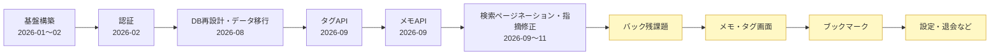

# sundlf-replace2 オンボーディング資料

- 最終更新: 2026-11-02
- 対象ブランチ: main(commit `7f39a14`)

しばらく離れていた人が「いま何ができていて、次に何をやるのか」を最短で掴むための**現状スナップショット**です。
守るべきルールは `CLAUDE.md` / `backend/CLAUDE.md` / `frontend/CLAUDE.md` / `.kiro/steering/` にあります。この資料は「状態」を書く場所です。

---

## 1. TL;DR(30秒で把握)

- 旧システム「my-wiki」(メモ+ブックマーク管理アプリ)を **Laravel 12 + Vue 3 の SPA** で作り直すプロジェクト。
- **バックエンド**: 認証・**タグAPI(5本)・メモAPI(8本)は実装済み・テスト済み**。旧DBからのデータ移行コマンドもある。
- **フロントエンド**: **認証画面(登録・ログイン)だけ**。メモ・タグの画面は**まだ1つもない**。
- **ブックマーク**: モデルとテーブルだけ。API・画面・仕様書はまだない(メモ・タグが終わってから作る方針)。
- **次にやること**: (A) バックエンドの細かい残課題(issue #118, #120, #122, #123, #127 など)を片付ける → (B) メモ・タグのフロント実装に入る。



---

## 2. 進捗サマリ

| 領域 | バックエンド | フロントエンド | 仕様書(`doc/定義`) |
| --- | --- | --- | --- |
| 認証(登録・ログイン・ログアウト・ユーザー取得) | ✅ 完了 | ✅ 登録・ログイン画面 | `.kiro/specs/register` |
| タグ(作成・更新・削除・検索・全件取得) | ✅ 完了 | ❌ 未着手 | ✅ あり |
| メモ(作成・取得・更新・削除・復元・完全削除・検索・閲覧数) | ✅ 完了 | ❌ 未着手 | ✅ あり |
| ゴミ箱(論理削除メモの検索) | ✅ メモ検索APIの `is_in_trashbox` で対応 | ❌ | ✅ あり |
| ゴミ箱の30日後自動削除 | ❌ 未実装(#117) | — | ✅ あり |
| スター(重要度 0〜5) | ✅ メモのカラムとして対応 | ❌ | ✅ あり |
| ブックマーク | ⚠️ モデル・テーブルのみ | ❌ | ⚠️ DB定義のみ |
| 退会(`user.cancel-membership`) | ❌ 未実装 | ❌(設定画面ごと) | ✅ あり |
| 旧データ移行(`legacy:import`) | ✅ コマンドあり(本番実行は未) | — | — |
| エラー画面・旧URLリダイレクト | — | ❌ 未実装(現在は未知のURLを `/` に飛ばすだけ) | ✅ `機能/その他.md` |

---

## 3. 実装済みのもの(詳細)

### 3.1 API 一覧(`backend/routes/api.php`)

すべて `/api` 配下。`spa.register` / `spa.login` 以外は `auth:sanctum` が必要です。

| ルート名 | メソッド・パス | 用途 |
| --- | --- | --- |
| `spa.register` | POST `/spa/register` | 会員登録 |
| `spa.login` | POST `/spa/login` | ログイン(`throttle:10,1`) |
| `spa.logout` | POST `/spa/logout` | ログアウト |
| `spa.user` | GET `/spa/user` | ログイン中ユーザー取得 |
| `tags.create` | POST `/tags` | タグ作成 |
| `tags.update` | PATCH `/tags/{id}` | タグ更新 |
| `tags.delete` | DELETE `/tags/{id}` | タグ削除 |
| `tags.all` | GET `/tags/all` | 全タグ取得 |
| `tags.search` | GET `/tags` | タグ検索(ページネーション対応) |
| `memos.create` | POST `/memos` | メモ作成(タグ同期あり) |
| `memos.search` | GET `/memos/search` | メモ検索・ゴミ箱検索(ページネーション対応) |
| `memos.view-count.increase` | POST `/memos/view-count/increase/{id}` | 閲覧数+1(`updated_at` は変えない) |
| `memos.salvage` | POST `/memos/{id}/salvage` | ゴミ箱から復元 |
| `memos.complete-deletion` | DELETE `/memos/{id}/completely` | 完全削除 |
| `memos.fetch` | GET `/memos/{id}` | メモ取得 |
| `memos.update` | PATCH `/memos/{id}` | メモ更新(楽観的ロック、`fetched_at` 必須) |
| `memos.delete` | DELETE `/memos/{id}` | 論理削除(ゴミ箱へ) |

> `GET /api/test/auth` は疎通確認用の仮ルートです。

API仕様の正本は `doc/定義/api/` にあります。実装中に変えた点もドキュメントへ反映済みです(commit `00f2efb`)。

### 3.2 バックエンドの設計で押さえておくこと

- **MVC + Usecase**: Controller は薄くし、ロジックは `app/Usecases/[Domain]/` の `__invoke` に書く。
- **Entry 基盤**: `Memo` と `BookMark` は抽象クラス `App\Models\Entry` を継承する。共通 trait(`app/Models/Concerns/`)は次の4つ。
  - `Trashable`: 論理削除・復元、`is_in_trash`、削除期限が近いかどうかの判定(30日で削除、残り7日で警告)
  - `DetectsStaleData`: 楽観的排他制御
  - `HasIncrementableCount`: 閲覧数を増やす(`updated_at` は変えない)。#127 で閲覧数は `article_statuses` / `book_mark_statuses` へ移す予定(`doc/定義/db/` 参照)
  - `HasOwner`: 所有者かどうかの判定
- **テーブル名は旧システムのまま**: `Memo` のテーブルは `articles`、中間テーブルは `article_tags`。
- **他人のリソースは 404**: `AssertOwner` は 403 ではなく 404 を返し、本文も「存在しない」場合と同じにしている(IDOR 対策)。
- **同時実行対策**: 削除・復元・完全削除は `lockForUpdate()` で再取得してから処理する。更新はトランザクション内で `fetched_at` を比較し、競合したら 409(`StaleDataException`)を返す。
- **タグの `count`(使用回数)**: 作成・更新では差分だけ増減する。論理削除で減らし、復元で戻す。完全削除では触らない。#127 で `tag_statuses` へ移す予定。
- **独自例外**: `OriginalException` を継承する(`NotFound` / `Forbidden` / `Duplication` / `Unauthenticated` / `StaleData` / `Unprocessable`)。
- **検索**: `SearchToolKit::parseSearchQuery()` で AND / マイナス検索とLIKEエスケープを処理する。`ESCAPE` 句はDBドライバごとに分けている。

詳しくは `.research-docs/` を参照してください。

| ファイル | 内容 |
| --- | --- |
| `backend-entry-usecase-architecture.md` | Entry基盤・usecaseの共通パターン・count設計・ロック設計 |
| `backend-entry-usecase-architecture.branch-fix-oversight.md` | 上記の fix/oversight 版(`has_tags` 同期の検討を含む) |
| `backend-search-pagination.md` | 検索ページネーションの設計 |

### 3.3 フロントエンド(`frontend/src/`、FSD構成)

- 画面: `/`(Welcome)、`/auth/register`、`/auth/login` のみ。
- 認証まわり: `entities/auth`(store・API・登録/ログイン処理)、ルートガード(`AuthUserGuard` / `GuestUserGuard`)。画面を移動するたびにサーバーへ認証状態を確認している。
- 共通: `shared/api`(`apiClient` / `ziggyRoute`)、`shared/layout`(`AuthLayout` / `GuestLayout`)、`shared/ui`。
- `entities/counter`、`pages/about`、`shared/ui/icons/*` は Vue テンプレートの名残なので、消してよい候補です。

### 3.4 テスト

- バックエンド: Feature テスト(Auth / Tag / Memo / Entry モデル)と Unit テスト(`SearchToolKit`)が計17ファイルあり、テストメソッドはおよそ150件。
- フロント: `entities/auth/__tests__/registerByCredentials.test.ts` だけ。
- この資料の作成時はコンテナが止まっていたため、テストは実行していません。再開したら最初に全テストを流してください。

---

## 4. 未実装・残課題

### 4.1 機能として未実装

| 項目 | 状態・メモ |
| --- | --- |
| **メモ・タグの全画面** | 仕様は `doc/定義/フロント/画面/{メモ,タグ}/` とコンポーネント定義(ヘッダー・メニュー・タグモーダル)にある。ページネーションUIの案は `.research-docs/backend-search-pagination.md` にある |
| **ブックマーク** | `BookMark` / `BookMarkTag` モデルと `book_marks` / `book_mark_tags` テーブルだけ。API・機能・画面の仕様書から作る必要がある |
| **ゴミ箱の自動削除**(#117) | `routes/console.php` にスケジュール登録がない。30日経過したら完全削除するバッチが必要 |
| **退会API・設定画面** | 仕様は `doc/定義/api/退会api.md` と `フロント/画面/設定.md` にある |
| **エラー画面・旧URLリダイレクト** | `Article/*` → `memo/` などのリダイレクト。仕様は `doc/定義/機能/その他.md` |
| 本番データ移行(#101) | `php artisan legacy:import` はある(`--dry-run` / `--fresh` 対応)。本番では未実行 |
| パスワードリセット・変更(#66, #34)、多言語(#62)、ダークモード(#72) など | アイデア段階 |
| インフラ(CI/CD #32、nginx #30、https #26、Terraform #29) | 未着手。CI(GitHub Actions)もまだない |

### 4.2 バックエンドの直近の残課題(優先度高)

| issue | 内容 | 補足 |
| --- | --- | --- |
| #118 | `articles.has_tags` を作成・更新時に同期していない | **途中までの実装が `git stash` の `stash@{0}`("On fix/oversight: has_tags")に残っている**。#127 の方針次第で扱いが変わる |
| #122 | タグの `count` を増減すると `updated_at` まで更新され、検索の並び順に影響する | 増減処理を Tag モデルにまとめる案あり |
| #127 | `count` や `has_tags` など、ユーザーが直接変えない項目を `〇〇_statuses` テーブルに分ける | #118 と #122 の根本対応。方針は決定済みで、定義は `doc/定義/db/*_statuses.md` にある。実装は未着手 |
| #120 | `articles.body` が NOT NULL になっている(nullable にしたい) | マイグレーションの修正 |
| #123 | `created_at` / `updated_at` が nullable になっている | 原因不明 |
| #121 | 検索結果が0件のとき 404 を返すだけになっている | クエリ情報付きで返したい |
| #112 | メッセージを `「{タイトル}」を削除しました` の形にする | ドキュメントも合わせて直す |
| #115, #116 | トランザクション対応・検索ロジックの分割 | リファクタリング |

> おすすめの順番: **#127 の方針を決める → #118 / #122 → #120 / #123(マイグレーション)** → フロント着手。
> DB構造の変更をフロント着手前に済ませておくと、`schema.d.ts` の作り直しが1回で済みます。

### 4.3 未確認・注意点

- `UpdateMemoUsecase` で `title` / `body` に空文字を送るとクリアできるかは未検証(`ConvertEmptyStringsToNull` の影響がありうる)。
- ルートの `CLAUDE.md` には生成ファイルの出力先が `frontend/src/lib/api/generated/` と書いてあるが、**実際の出力先は `frontend/src/shared/api/ziggy.js` と `frontend/src/shared/types/{ziggy.d.ts,schema.d.ts}`**(`mise.toml` が正)。CLAUDE.md を直す必要がある。
- `.kiro/specs/` にあるのは `register` だけ(完了済み)。タグ・メモは kiro を使わず `doc/定義/` を仕様書として GitHub issue 単位で進めてきた。
- ローカルブランチが30本以上残っていて、ほとんどはマージ済み。`git stash` も13件ある(`stash@{0}` 以外はほぼ古い)。整理してよい。

---

## 5. 開発環境の起動

```bash
# 1. コンテナ起動(laravel :8000 / vue :5173 / mariadb :3306)
docker compose up -d

# 2. git hooks の有効化(初回だけ)
lefthook install

# 3. 自動生成ファイルの作り直し(ziggy / openapi / ide-helper)
mise generate:init

# 4. DB初期化(migrate:fresh + seed)
mise reset-database
```

| 用途 | コマンド |
| --- | --- |
| Laravel コンテナでコマンドを実行 | `mise exec:laravel "<command>"` |
| Vue コンテナでコマンドを実行 | `mise exec:vue "<command>"` |
| バックエンドの全テスト | `mise exec:laravel "composer run test"` |
| PHPStan / Pint | `mise exec:laravel "composer run phpstan"` / `"composer run pint"` |
| フロントのテスト・型チェック | `mise exec:vue "pnpm run test:unit"` / `"pnpm run type-check"` |
| ルート・APIスキーマの再生成 | `mise generate:ziggy` → `mise generate:openapi` |

> 旧データを入れる場合は `legacy:import` を使います。シードを流さず、`migrate:fresh` 直後に実行してください(id=1 が衝突するため)。手順は `ImportLegacyDataCommand.php` の先頭にあるコメントを参照。

### Git hooks(`lefthook.yml`)

- **pre-commit**: pint → phpstan、prettier → eslint → oxlint。さらに PHP の変更をきっかけに `generate:ziggy` / `generate:openapi` / ide-helper を**自動で実行**する(コンテナが起動していないと失敗する)。
- **pre-push**: フロントの型チェック。

---

## 6. 開発フロー

1. GitHub issue を立てる → `feature/issueNN` / `task/issueNN` / `fix/xxx` ブランチを切る。
2. 仕様は `doc/定義/{機能,api,db,model,フロント}/` に書く(テンプレートあり)。
3. バックエンドを実装 → `mise generate:ziggy` → `mise generate:openapi` → フロントを実装。
4. PR を作る(テンプレートは `.github/pull_request_template.md`、本文は `/PrePR` スキルで下書きできる)。CodeRabbit のレビューは `/CoderabbitFixGithub` で反映する。
5. 調査でわかったことは `.research-docs/` に残す(ブランチ名・commit・日付を必ず書く)。

### 手で編集してはいけない自動生成ファイル

- `frontend/src/shared/api/ziggy.js`
- `frontend/src/shared/types/ziggy.d.ts`
- `frontend/src/shared/types/schema.d.ts`
- `backend/_ide_helper*.php`、モデルの `@property` PHPDoc(ide-helper)

---

## 7. 主要ドキュメントの場所

| 場所 | 中身 |
| --- | --- |
| `doc/定義/` | 機能・API・DB・モデル・画面の仕様書(正本) |
| `doc/レビュー結果/` | `doc/定義` のレビュー結果(すべて対応済み) |
| `doc/*.md` | ツールのメモ(ziggy / openapi / lefthook / mdi / vue-router / ide-helper / serena / 技術選定) |
| `.research-docs/` | 実装を調査した結果の記録 |
| `.kiro/steering/` | プロダクト・技術・構成のルール |
| GitHub issue #69 | 全体スケジュール(ログイン ✅ / 記事 / ブックマーク) |
